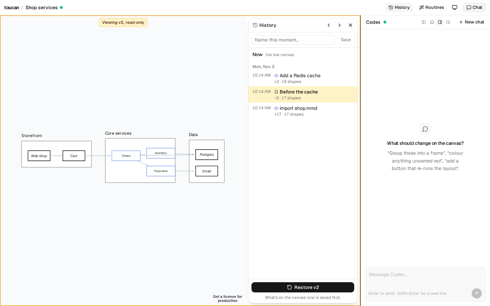
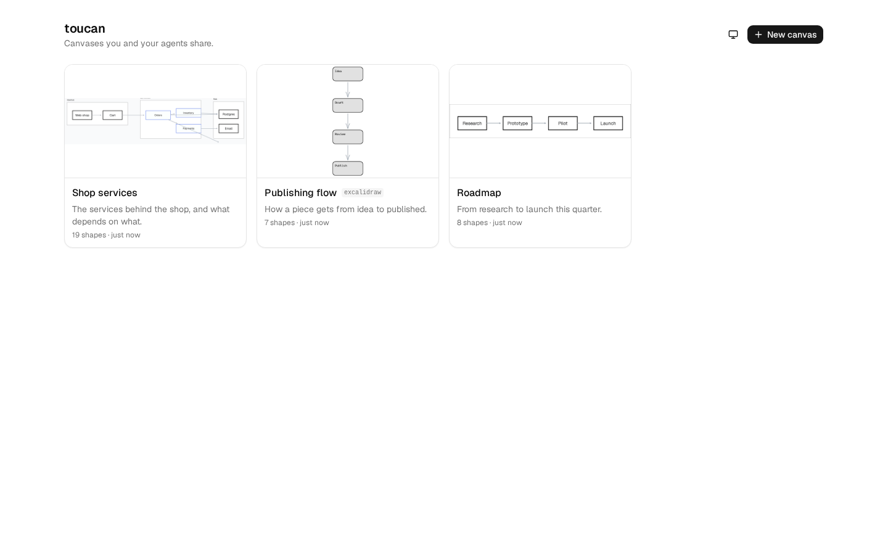

# toucan

[](https://github.com/lavallee/toucan/actions/workflows/ci.yml)
[](./LICENSE)

An infinite canvas in the browser that you edit by hand while agents edit it beside you.

**[Read the docs →](https://lavallee.github.io/toucan/)**



Each canvas runs on [tldraw](https://tldraw.dev) or [Excalidraw](https://excalidraw.com). A small Node
server keeps every open tab in sync, a chat panel drives [Codex](https://github.com/openai/codex) on your
own ChatGPT sign-in, and any terminal agent (Claude Code, Codex, pi, …) can do the same through the
`toucan` CLI: read the canvas, send JavaScript to the live editor, take a screenshot, or merge in a
Mermaid / JSON Canvas / Excalidraw file by key.

```
 browser ──── http://HOST:8893/?canvas=NAME
   ├─ tldraw or Excalidraw canvas  ◀── exec relay (WebSocket) ──┐
   └─ chat panel                   ◀── chat relay (WebSocket) ──┤
                                                                │ server/index.mjs
                                                                ├─ codex app-server (stdio; your ChatGPT login)
                                                                │     └─ runs `toucan …` to read/change the canvas
                                                                ├─ one sync room per canvas → <data>/<name>.json | .excalidraw
                                                                └─ canvas scripts → <data>/<name>.scripts/*.js
 terminal agents ── toucan … (same path)
```

## Quick start

Needs Node 22+, and the [Codex CLI](https://github.com/openai/codex) signed in (`codex login`) if you want
the chat panel.

```sh
git clone https://github.com/lavallee/toucan && cd toucan
npm install
npm run build
npm start                          # http://127.0.0.1:8893
node bin/toucan.mjs url            # prints the sign-in link (with its token); open it once per browser
```

Then make a canvas from the index page, or from the terminal:



```sh
node bin/toucan.mjs new sketch --title "Sketch"
node bin/toucan.mjs --canvas sketch summary
node bin/toucan.mjs --canvas sketch exec -e 'toucan.node("hello", { x: 0, y: 0, text: "Hello" }); return toucan.summary()'
```

Put `bin/toucan.mjs` on your PATH as `toucan` (e.g. `ln -s "$PWD/bin/toucan.mjs" ~/.local/bin/toucan`) and
point your agent at [AGENTS.md](AGENTS.md); it is the guide every agent works from.

## What it does

- **Hand edits and agent edits on one document.** Tabs on any machine share a live document; agents
  change it through an exec relay into the most recently focused tab, so you see every edit land.
- **Chat.** A panel talks to Codex; dock it left, right or along the bottom, or float it over the canvas. Fast
  (the default) acts right away, and Thorough thinks longer. Add to a request while it's running. `/routine-name`
  or a pasted Mermaid flowchart lands at once, with no agent. It inspects the canvas, makes edits, and can install
  *canvas scripts* — persistent behaviour (a button, a live overlay, a reaction to edits) that runs
  whenever the canvas loads. Anything outside Codex's sandbox asks you first.
- **Two engines.** Each canvas is tldraw (default) or Excalidraw. Copying a canvas converts it between them.
- **Interchange.** `toucan graph --format tg|jsoncanvas|mermaid|dot|excalidraw` exports without a tab;
  `toucan import FILE` merges JSON Canvas, Mermaid, `.excalidraw` or TG into the open canvas *by key*:
  existing shapes keep their position, new ones are laid out with ELK, nothing is deleted without `--prune`.
  The converters are in [`lib/tg.mjs`](lib/tg.mjs).
- **Threads.** Comment on a shape or drag out a region. Each comment is a thread you go back and forth in and close
  out: give it to its own agent (several can work at once, and you can steer each one), send it into the main chat, or
  leave it for people. They work on both engines and with no tab open, and `toucan threads` does the same from the CLI.
- **Formats and details.** Boxes stay short, and selecting one opens its detail in a card. A story map, ideas map or system diagram
  lets you walk the canvas with ← and →, following arrows or frames, and tells agents how to work on it. **Air out** converts a dense diagram.
- **Notes for the agent.** On tldraw, a sticky note is addressed to the agent: pin one where the problem
  is, and `toucan notes` gives the agent its text and the shapes it sits on and near. A handled note turns
  green with a one-line reply; notes are never deleted.
- **Proposals.** An agent can answer on the canvas with a proposal: dashed shapes (`import --propose`)
  that you accept (made solid) or reject (removed) from a bar above the canvas.
- **History.** Every canvas keeps its own versions: after each agent run, when your edits go quiet, and whenever
  you name one. Step back and forward through them read-only, and restore any of them for everyone; what was
  there is saved first, so a restore can be undone too. `toucan versions` does the same from the CLI.
- **Routines.** Bank a chore once and run it on any canvas from the Routines menu or `toucan routine run`, as
  one undo step. Ask the chat to "bank that", or paste code. Tidy arrows and Straighten sketchy lines ship with toucan.
- **Your look.** A light/dark/system override, and clean lettering by default in place of tldraw's handwritten
  font (switch back under Appearance). It's per browser, and it doesn't change the canvases.
- **An index of canvases** at `/`, with previews, titles, descriptions and which ones are open.
- **Headless mode (opt-in).** Start the server with `--headless` and an agent can build or tend a canvas
  nobody has open: the server opens it in headless Chromium, runs the code in the real editor there, and
  closes it when idle. Those edits go on the canvas's trail (`toucan log`), and the next person to open
  the canvas sees "N agent edits while you were away".

## CLI

```
toucan [--canvas NAME] <command>
  url                         sign-in link for the browser
  canvases                    list canvases
  new NAME [--engine tldraw|excalidraw] [--from CANVAS|FILE] [--title T] [--description D]
  graph [--format tg|jsoncanvas|mermaid|dot|excalidraw] [OUT]
  import FILE|- [--format F] [--move] [--prune] [--propose] [--label T]
  meta [--title T] [--description D]
  archive                     move a canvas aside (nothing is deleted)
  summary [--within KEY]      compact JSON of shapes
  exec -e CODE | FILE | - [--label T]   run JS in the live editor; `return` a JSON value
  screenshot [OUT.png]        PNG of the page
  script list | put NAME FILE | rm NAME
  proposals [accept|reject [KEY...]]   dashed = proposed: list, accept or reject
  selection                   what people have selected, to resolve "this"
  notes [--all]               sticky notes left for the agent, with the shapes they're on and near
  notes resolve KEY --reply T mark a note handled: green, plus a one-line reply
  log [--since T]             edits agents made with no tab open (T: ISO time, or an age: 30m, 2h, 7d)
  versions [save LABEL | show N [--format F] | restore N]   the canvas's history
  threads [--all] | show N | new TEXT --on KEY,KEY | --region X,Y,W,H [--ask] | reply N TEXT [--ask] | close N [--reply T] | reopen N | adopt-notes
  files                       where this canvas keeps what agents write for it
  routine list | show NAME | run NAME [--args JSON] | save NAME FILE [--title T] [--description D] [--engines E] | rm NAME
```

`--canvas` can also come from `TOUCAN_CANVAS`. `exec`, `summary`, `screenshot` and `import` run in a
browser tab on the canvas; without one they fail, unless the server runs in headless mode.

## Headless mode

```sh
npx playwright-core install chromium   # once; playwright-core is an optional dependency
npm start -- --headless                # or TOUCAN_HEADLESS=1 npm start
```

When an `exec` (and so `summary`, `screenshot` or `import`) finds no tab on the canvas, or no tab
answers, the server opens the canvas itself in headless Chromium and runs the code there. It is the
normal app, so edits go through the real editor and sync like anyone's. People's tabs always come
first. There is at most one headless page per canvas and `TOUCAN_HEADLESS_MAX` in all; a page closes
after `TOUCAN_HEADLESS_IDLE` seconds without an exec, and Chromium closes with the last page. Expect
about half a second to two seconds for the first exec on a cold canvas and a few hundred MB of memory
per open page.

Edits made there are recorded in `<data>/<name>.log.jsonl`: time, source, what ran, and the keys
added, updated or removed. `toucan log` prints them; the app shows "N agent edits while you were
away" until you mark them seen (per browser).

## Extending

- **Canvas scripts** grow a single canvas, and **routines** are chores for every canvas; see [AGENTS.md](AGENTS.md).
- **Extension commands.** `toucan X …` runs `toucan-X …` from your PATH, with `TOUCAN_CANVAS` set, so
  domain-specific tooling (a diagram generated from your own data, say) lives in its own repo. From
  Node, use the same client the CLI does:

  ```js
  import { connect } from 'toucan/client'   // or ../toucan/lib/client.mjs
  const t = connect({ canvas: process.env.TOUCAN_CANVAS })
  await t.exec('return toucan.summary()')
  ```

- **Deployment notes for agents.** An `AGENTS.md` in the data directory is passed to the chat agent as
  extra instructions, so your house canvases and extensions are documented without forking.

## Try it on a book

Two ready-made canvases, each built from a public-domain text:

```sh
toucan new meditations --from examples/meditations.tg.json --canvas-format ideas --title "Meditations: a map of ideas" \
  --description "Marcus Aurelius in George Long's translation. Every passage is his wording, with book and section."
toucan new odyssey --from examples/odyssey.tg.json --canvas-format story --title "The Odyssey: a story map" \
  --description "Homer in Samuel Butler's translation, which uses Roman names. Every line is Butler's, with its book."
```

Open one, click a box to read it, and walk with ← and →. Then click **Comment**, drag around a cluster, and ask something: "what's the argument here?" or "where does he
disagree with himself?". Every quotation was checked word for word against its source by `scripts/build-maps.mjs`.

## Agent plugin

The `toucan` skill teaches Claude Code and Codex to drive a canvas. Install it from the Lyra Forge marketplace:

```
/plugin marketplace add lyra-forge/marketplace      # Claude Code
/plugin install toucan@lyra-forge

codex plugin marketplace add lyra-forge/marketplace # Codex
codex plugin add toucan@lyra-forge
```

## Configuration

| Setting | Default | |
|---|---|---|
| `--host` / `TOUCAN_HOST` | `127.0.0.1` | interface to listen on |
| `--port` / `TOUCAN_PORT` | `8893` | |
| `--data` / `TOUCAN_DATA` | `canvases/` in the checkout | where canvases, scripts and previews live |
| `--headless` / `TOUCAN_HEADLESS=1` | off | run exec in headless Chromium when no tab has the canvas open |
| `TOUCAN_CHAT_FAST_MODEL`, `TOUCAN_CHAT_THOROUGH_MODEL` | Codex's default | model for each chat speed |
| `TOUCAN_CHAT_FAST_EFFORT`, `TOUCAN_CHAT_THOROUGH_EFFORT` | `low`, `medium` | reasoning effort for each chat speed |
| `TOUCAN_HEADLESS_IDLE` | `120` | seconds a headless page stays open after its last exec |
| `TOUCAN_HEADLESS_MAX` | `2` | headless pages open at once (the least recently used idle one makes room) |
| `TOUCAN_PUBLIC_HOST` | `127.0.0.1`, or the hostname when bound to all interfaces | host used in printed links |
| `TOUCAN_CANVAS` | — | default canvas for the CLI |
| `TOUCAN_URL` | from `~/.config/toucan/server.json` | server the CLI talks to |
| `VITE_TLDRAW_LICENSE_KEY` | — | tldraw licence key, read at build time (see below) |

## Security

The exec relay runs arbitrary JavaScript in your browser tab, and the chat drives an agent with a shell.
Every HTTP and WebSocket request therefore needs the token in `~/.config/toucan/server.json` (created
on first start, mode 0600; delete its `token` field and restart to rotate). The server listens on
loopback by default; only bind it wider (`--host 0.0.0.0`) on a network you trust, and put it behind
HTTPS if it leaves your machine. Codex runs with `workspace-write` rooted at this checkout and
`on-request` approval.

Headless mode adds no new way in: the headless page is a local Chromium the server starts itself. It
gets the token through a script that puts it in the page's (in-memory, throwaway) local storage, never
in a URL, and then authenticates like any tab.

## Licences

toucan's own code is [MIT](LICENSE). It builds on **tldraw**, which is *not* MIT: the
[tldraw licence](https://github.com/tldraw/tldraw/blob/main/LICENSE.md) allows development use freely,
but production use (anything served over HTTPS) needs a licence key, including tldraw's free hobby
licence for non-commercial projects. Put the key in `.env` as `VITE_TLDRAW_LICENSE_KEY=…` and rebuild.
Excalidraw canvases need no key (MIT).

## Develop

```sh
npm run dev           # server + vite with hot reload
npm run typecheck
npm test              # round-trip checks for the graph converters, and the trail
npm run test:headless # end to end: a headless server builds canvases on both engines with no tab open
npm run css:preflight # regenerate app/preflight.css after upgrading tailwindcss
```

React 19 + TypeScript under `app/` (Vite), tldraw 5 / Excalidraw 0.18 for the canvas, Tailwind v4 and
shadcn/ui for toucan's own UI; the chat panel follows shadcn's AI Elements patterns. Tailwind's preflight
is scoped to `.toucan-ui` and layered beneath tldraw's CSS, so it never touches the canvas. More detail
on sync, exec routing and the chat relay is in [How it works](https://lavallee.github.io/toucan/how-it-works.html).

## Contributing

See [CONTRIBUTING.md](CONTRIBUTING.md), [SECURITY.md](SECURITY.md) and [RELEASING.md](RELEASING.md). Changes are in [CHANGELOG.md](CHANGELOG.md).
