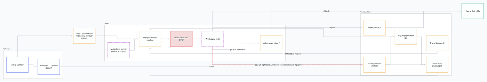
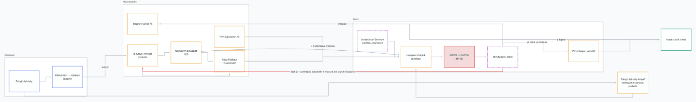
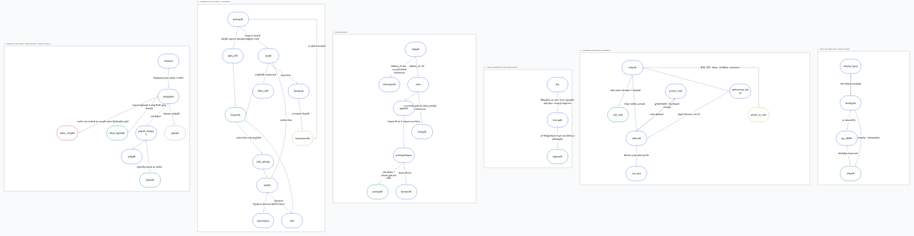
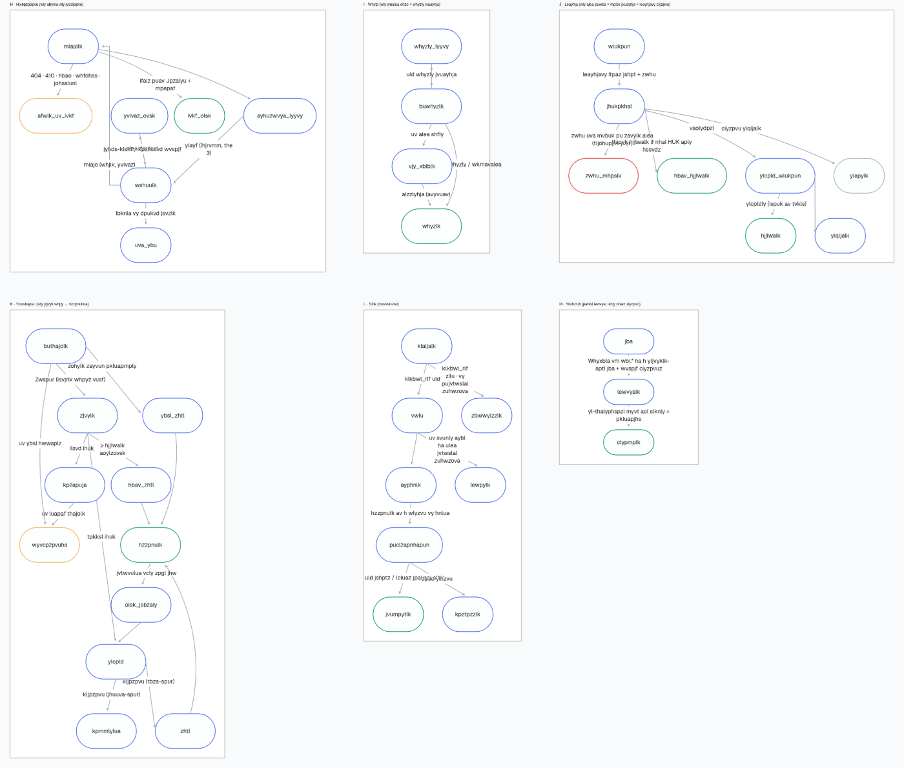
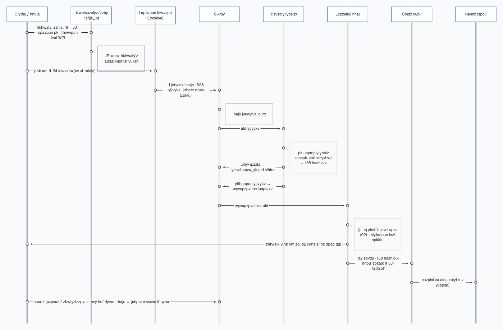
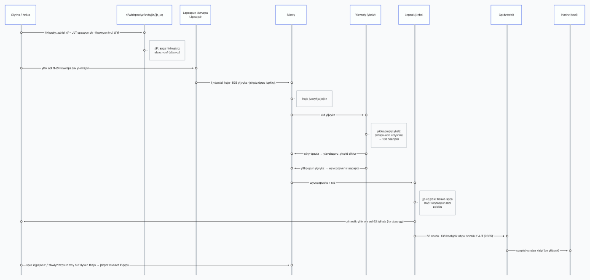
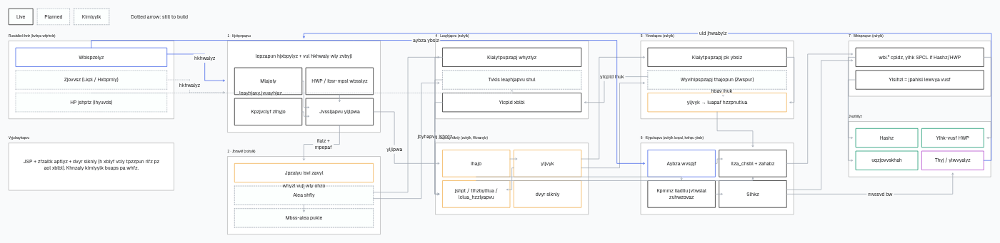
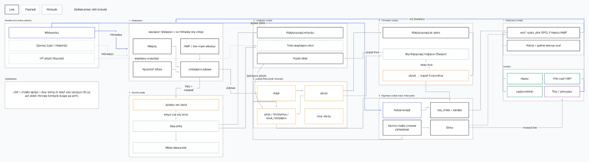

# Layout improvements from the redesign test

Branch `layout-from-redesign-test`, from `origin/main` `87c9baa`. Eight of the eleven ranked improvements from the
D2-versus-Toucan study are done (1–8); 9, 10 and 11 are not. Nothing is merged, pushed, tagged or released.

The study drew ten architecture diagrams on one canvas and compared Toucan's layout with D2's on identical content. Its
specs are kept outside this repository, because they name a private project. This repository carries
`scripts/fixtures/redesign/`: the same structure, word lengths and arrows, with the words scrambled. The scores in the
tables below were measured on the real specs, laid out headless on a scratch canvas. The repository's own checks and
`npm run test:diagrams` use the fixtures, which lay out the same way.

## What changed

| # | Change | Where | Checked by |
|---|---|---|---|
| 1 | `flow()` breaks cycles in the order the author wrote (ELK `MODEL_ORDER`) | `lib/layouts.mjs` | `layouts-check`: d01 groups run left to right in written order, at most 2 crossings |
| 2 | `flow()` lays out pieces that have no arrows between them one by one and packs them in rows (`columns`, `aspect`); a group in a downward flow is as narrow as its boxes, and no narrower than its name | `lib/layouts.mjs` | `layouts-check`: d04-one is 3 × 2 in A–F order, 2800 wide (was 6890), no frame overlaps, no frame narrower than its name |
| 3 | `map()` spaces tiles for the arrows between them; a link takes `dash: "dashed"` without meaning "planned" | `lib/layouts.mjs` | `layouts-check`: d02 arrows inside a panel have room for their labels; dashed links are dashed and not in the "still to build" key; planned links stay dotted |
| 4 | `draw --prefix`, clash renames only generated keys, `--update` redraws where the section is, `--frame KEY --title T` (also `toucan_draw`) | `bin/toucan.mjs`, `lib/layouts.mjs` (`placeDrawing`, `placeBeside`, `frameDrawing`), `lib/mcp.mjs` | `layouts-check`; also run by hand on a scratch server (see below) |
| 5 | Boxes and sequence participants are as wide as their longest word; sequence gaps fit the label across them, rows fit their label or self-message note | `lib/boxes.mjs`, `lib/layouts.mjs` | `layouts-check`: `typed_no_body` is one line in an oval, rectangle, diamond and hexagon; d09 participants hold their words; no note sits on another message's arrow |
| 6 | `measure({ within })` and every `tidy.*({ within })` look at one frame; a canvas of several sections is scored per section, and `score` is the mean | `app/scene.js` (`scopeScene`), `app/measure.js`, `app/tidy.js`, both helpers | `test:diagrams` (new redesign section) |
| 7 | New findings: frame name cut off, arrows share a run, word broken inside a box, label under a box, frame mostly empty; grid cells are not "uneven column" | `app/measure.js`, `lib/layouts.mjs` (`meta.grid`) | `test:diagrams`: each fires on a hand-built case; none fires on d05 or d10 |
| 8 | `toucan screenshot` draws at full size (up to 4096 px) and shrinks, so labels do not wrap at a small scale | `app/helpers.js` | `test:diagrams`: `--max 480` gives a picture about 480 px wide; before/after pictures below |

Documentation: `CHANGELOG.md` (Unreleased), `docs/agents/editing.md` and `cli.md` (which `toucan guide editing` and `cli`
serve), `website/content/agents.md` and `features.md`.

### Draw, run by hand

On a scratch server (port 8931, scratch data directory, headless), with `d05` drawn as `--prefix a-`, `--prefix b-` and
then with no prefix: all 105 keys were created, none with a `d2-` prefix. Moving the `a-` drawing by (+500, +300) and then
running `draw --update --prefix a-` kept its top left at (500, 300). `draw d10 --frame sec-10 --title Ten` made the frame
and put the diagram in it.

## Scores: the ten sections, before and after

`measure()` of each spec laid out headless on its own scratch canvas, no frame. "Before" is `87c9baa`. "After, old checks
only" adds back the penalties of the five new findings, so that layout and measuring can be told apart; the new checks
cost points where they find something.

| spec | before | after | after, old checks only | size before → after |
|---|---|---|---|---|
| d01 flow, groups | 79 | 82 | **90** | 4600×730 → 4750×648 |
| d02 map | 59 | 54 | **62** | 3638×840 → 3778×992 |
| d03 flow, groups | 83 | 81 | **81** | 4820×2540 → 4780×1830 |
| d04-a machine | 63 | 67 | **71** | 740×550 → 860×550 |
| d04-b machine | 87 | 64 | **72** | 551×520 → 540×520 |
| d04-c machine | 73 | 80 | **88** | 820×710 → 1000×710 |
| d04-d machine | 73 | 85 | **89** | 580×1300 → 910×1170 |
| d04-e machine | 69 | 67 | **67** | 822×930 → 812×930 |
| d04-f machine | 94 | 94 | **94** | 297×400 → 297×400 |
| d04-one (six machines, one flow) | 52 | 29 | **41** | 6890×1740 → 2800×2370 |
| d05 grid | 100 | 100 | **100** | unchanged |
| d06 flow, groups | 97 | 91 | **95** | 3820×860 → 3910×1214 |
| d07 map | 98 | 98 | **98** | unchanged |
| d07-ci grid | 92 | 97 | **100** | unchanged |
| d08 flow, down | 81 | 81 | **81** | unchanged |
| d09 sequence | 69 | 76 | **76** | 2290×1480 → 3580×1670 |
| d10 map | 98 | 98 | **98** | unchanged |

Reading the table honestly:

- **Better:** d01 (79 → 90 on the old checks: groups in written order, one crossing), d02, d04-a, d04-c, d04-d, d09 (no
  text outgrew its box), d07-ci (the grid's false "uneven column" ×13 is gone).
- **Worse:** d04-b (87 → 72), d06 (97 → 95), d04-one (52 → 41), d03 (83 → 81). d04-b is a four-box machine that
  came out of the new cycle breaking with three labels running through arrows; with the old cycle breaking it scores 87
  again, while the other machines score about the same either way. d04-one is one flow of six machines: it is now a grid
  of 2800 px rather than a 6890 px row, but arrow labels in a downward group are no longer given room by ELK (which is
  what made group A 1750 px wide) and several now sit on or under boxes. That is the label-placement problem of
  improvement 11, which is not done.
- **The new checks find real things** in the old layouts' successors: d06 now reports the two arrows sharing a run (the
  study's finding), d03 a mostly empty frame, d07-ci a path longer than its row label's box.
- Whole canvas: the study's canvas scored 0 as one number. Here, with the ten fixtures each in a `draw --frame` frame,
  `measure()` reports a score for each section and their mean: **79** (the eval prints each section).

Per-section scores of the ten fixtures on one canvas, each in its frame (`npm run test:diagrams`, redesign section):
d01 82, d02 59, d03 75, d04-one 29, d05 100, d06 91, d07 98, d08 83, d09 75, d10 98; mean 79.

### Pictures

Fixtures (scrambled words), before and after, as `toucan screenshot` draws them.

| | before | after |
|---|---|---|
| d01 |  |  |
| d04-one |  |  |
| d09 |  |  |
| d02 |  |  |

The "before" pictures also show the screenshot bug (labels wrapping mid-word in a 6890 px board drawn at 1400 px); the
"after" ones are drawn at full size and shrunk. A picture drawn at `--max 700` wraps its labels the same way as one at
`--max 1400`.

## Decisions for a person

- **Cycle breaking only, not `considerModelOrder`.** The brief also asked for
  `considerModelOrder.strategy: NODES_AND_EDGES`. With it d01 scored 85 with four crossings; without it 90 with one, and
  d03 was no better. Only `cycleBreaking: MODEL_ORDER` is set.
- **`pipeline` baseline 98 → 97** in `evals/baseline.json`. The word-width rule makes "Deploy to production" a box
  wide enough for "production", so all boxes of the row widen and the picture is a little flatter. This is the only
  template that scored lower. Revert it if the baseline should not move.
- **Pieces grid:** counts that fill rows evenly are tried (six pieces: 6, 3, 2, 1 to a row) and the one nearest an aspect
  of 1.4 wins. d06's four disconnected groups also re-pack, into two rows; its score dropped from 97 to 95.
- **Brief asked for the grid's total width under 3000 and each group within 10% of its width alone.** d04-one is 2800
  wide. The groups are 400–1060 wide against 160–1000 alone; they are not within 10% (frames add 60 px and a frame is as
  wide as its name).
- **"Frame mostly empty"** fires below 10% coverage for frames of more than 20 boxes. The brief said 15% and 10 boxes,
  which also flags d01, d06 and d09 (a long row and a sequence are wide by nature); the study only saw d03.
- **"Arrows share a run"** counts a run past 40 px for arrows that share nothing, and past 200 px where they leave or
  arrive at the same box (a fork or a join); a chain is not a run.
- **"Label under a box"** is checked for the label's own end boxes (the case the study saw); another box was already
  "label on a box".
- **A clash on a key the author wrote** still moves the whole drawing aside with `d2-` (as before): drawing a section
  twice without `--update` must not overwrite it. Only a drawing whose clashing keys were all generated keeps its own.
- **Section frames:** a `draw --frame` frame is marked `meta.section`. A canvas with none marked is scored per section
  only if two or more top-level frames each hold frames of their own; the study's d05, d08 and d09 sections (no inner
  frames) would need marking.

## Not done

- 9 (`describe()` words for custom states, skipped markers, reading order), 10 (nesting for groups and panels, grid
  corner header) and 11 (curved state-machine arrows).
- The `evidence-engine-design` canvas and the live server were not touched; scores come from scratch canvases.
- `measure({ within })` and `tidy` scoping run on both engines in code, but the redesign check only exercises tldraw.
- No hand-built "label under a box" case in `test:diagrams` (it fires on real d04 layouts, which is how it was seen).
- `gitleaks` is not installed on this machine and is not among the tools this fleet provides, so it was not run (see below).

## Local CI

Run from a clean checkout of the final commit after `npm ci`.

CI_PENDING
